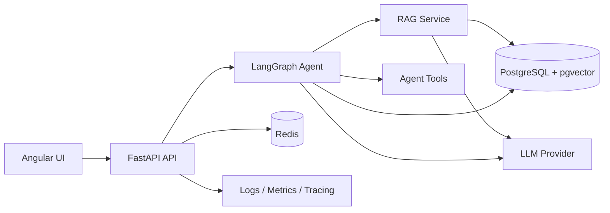
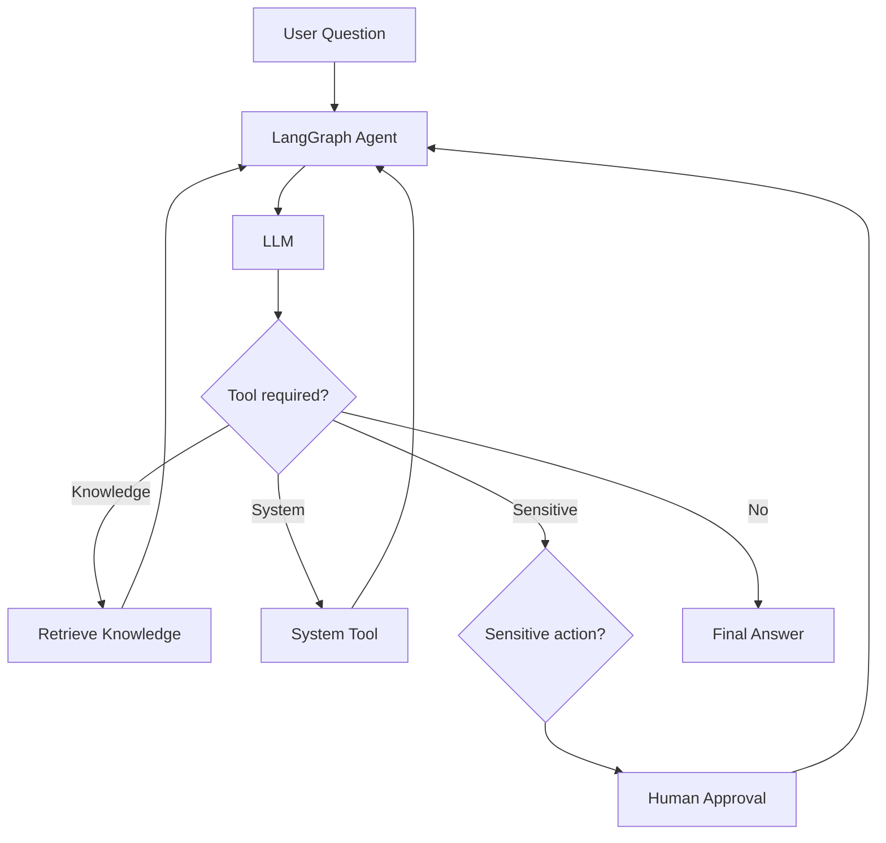

# AI Knowledge & Action Platform

A production-oriented AI engineering platform built with FastAPI, Angular, LangGraph, PostgreSQL/pgvector, Redis and configurable LLM providers.

The project demonstrates how retrieval-augmented generation, agentic workflows, persistent memory, human approval, evaluation, observability and software engineering practices can be combined in a single modular system.

## Overview

The platform allows users to upload knowledge documents, retrieve semantically relevant information, ask grounded questions and interact with an AI agent capable of selecting and executing tools.

The agent maintains conversation state across requests and can pause sensitive actions until a human explicitly approves or rejects them.

## Key Features

- Document ingestion for PDF, TXT and Markdown files
- Text parsing and configurable chunking
- Multilingual sentence embeddings
- PostgreSQL + pgvector semantic search
- Retrieval-Augmented Generation (RAG)
- LangGraph agent orchestration
- Dynamic tool calling
- Persistent conversation checkpoints
- Human-in-the-Loop approval
- Redis query-embedding cache
- Redis rate limiting
- Structured JSON logging
- Prometheus metrics
- Optional AI execution tracing
- Retrieval evaluation and quality gates
- Unit, integration and end-to-end tests
- Dockerized local environment
- GitHub Actions CI
- Angular dashboard
- Configurable local/cloud LLM providers

## Architecture



## Agent Flow



## Technology Stack

### Backend
Python, FastAPI, Pydantic, SQLAlchemy Async and Alembic.

### AI Engineering
LangGraph, LangChain, Ollama, configurable cloud LLM providers, sentence-transformers and RAG.

### Data
PostgreSQL, pgvector and Redis.

### Frontend
Angular, TypeScript, standalone components, Signals and HttpClient.

### Infrastructure
Docker, Docker Compose and cloud deployment.

### Quality
pytest, integration tests, E2E testing, retrieval evaluation, Ruff and GitHub Actions.

### Observability
Structured logging, request IDs, Prometheus metrics and optional AI tracing.

## Software Engineering Concepts

The project intentionally applies software engineering principles instead of concentrating all AI logic inside API endpoints.

**Dependency Inversion:** RAG and agent workflows depend on provider abstractions rather than a single concrete LLM implementation.

**Dependency Injection:** FastAPI dependencies inject database sessions, services and agent graphs.

**Separation of Concerns:** API routes, repositories, services, AI workflows, schemas and infrastructure are separated into dedicated modules.

**Repository Pattern:** database access is isolated from business logic.

**Configuration-driven architecture:** local and cloud environments can use different infrastructure and model providers without changing core application logic.

## Algorithms and Data Structures

The system applies computer-science concepts in real application code:

- linear text traversal during chunking
- hashing for deterministic cache keys
- vector similarity search
- Top-K retrieval
- threshold filtering
- graph-based agent execution
- fixed-window rate limiting
- indexed relational and vector data

## SQL and NoSQL

PostgreSQL stores durable relational information such as documents, chunks and LangGraph checkpoints.

pgvector extends PostgreSQL with vector similarity search for embeddings.

Redis stores temporary high-speed information such as query embedding cache entries and rate-limit counters.

This separation keeps persistent business data in a relational database while using an in-memory datastore for ephemeral workloads.

## Reliability

The agent includes several safety and reliability mechanisms:

- Pydantic input validation
- grounded RAG context
- semantic similarity thresholds
- deterministic routing fallback
- structured LLM output
- tool allowlisting
- Human-in-the-Loop approval
- agent recursion limits
- API rate limiting
- centralized exception handling
- liveness and readiness probes

## Testing Strategy

The project uses multiple testing layers:

```text
Unit Tests
    ↓
Integration Tests
    ↓
End-to-End Tests
    ↓
Retrieval Evaluation
    ↓
Quality Gate
```

The retrieval evaluation suite measures metrics such as Precision@K, Recall@K and Hit Rate.

## Local Development

Start infrastructure:

```bash
docker compose up -d
```

Start the Angular frontend:

```bash
cd frontend
npm install
npm start
```

Frontend:

```text
http://localhost:4200
```

API documentation:

```text
http://localhost:8000/docs
```

## Environment Configuration

Create a local `.env` from `.env.example`.

Secrets such as API keys and database passwords must never be committed.

The default local AI provider is Ollama.

Cloud environments can select another configured provider through environment variables.

## CI/CD

Every change is automatically validated with GitHub Actions.

The pipeline checks Python compilation, linting, automated tests, Angular production compilation and Docker image construction.

## Screenshots

### Dashboard


### Automated Test Suite


## What This Project Demonstrates

This project was designed as an applied Backend + AI Engineering system rather than a standalone chatbot demo.

It demonstrates:

- backend API design
- asynchronous persistence
- relational and vector databases
- RAG architecture
- agentic workflows
- LLM abstraction
- tool calling
- durable memory
- human approval
- caching and rate limiting
- evaluation
- observability
- testing
- CI/CD
- Docker
- frontend integration
- cloud-oriented architecture

## Status

Version 1.0.0 — portfolio release.
