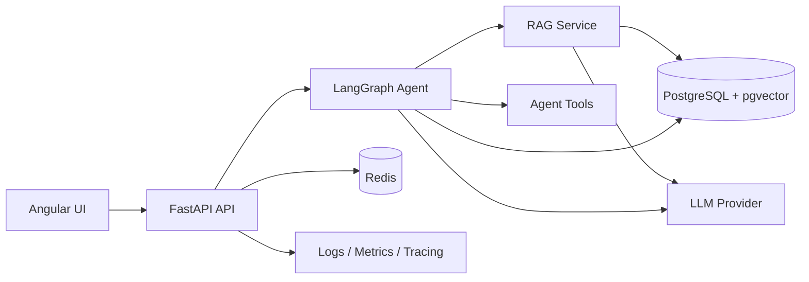
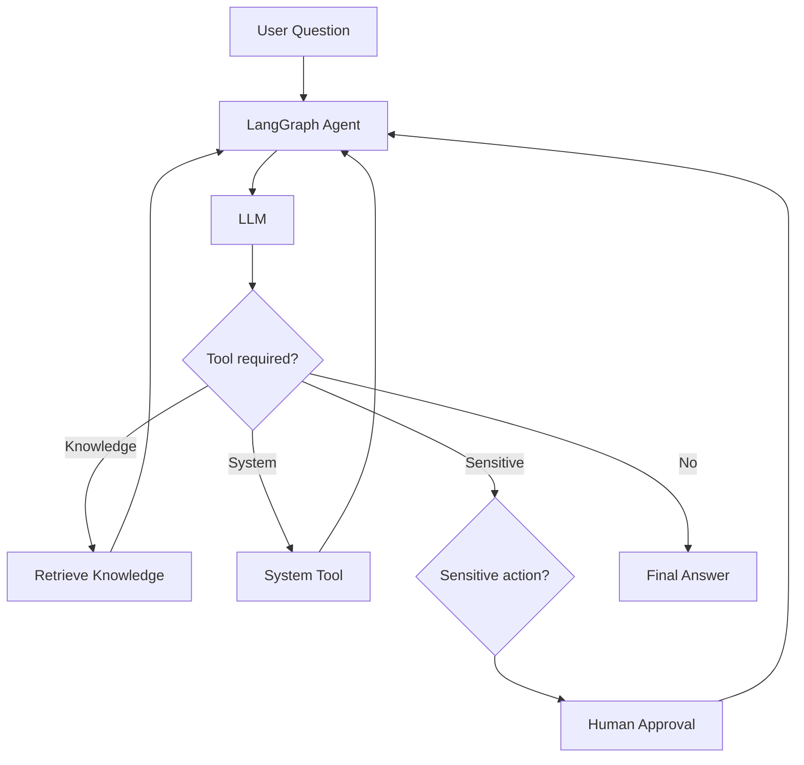

# AI Knowledge & Action Platform

A production-oriented AI Engineering platform built with FastAPI, Angular, LangGraph, PostgreSQL/pgvector, Redis and configurable LLM providers.

The project demonstrates how Retrieval-Augmented Generation, agentic workflows, persistent memory, Human-in-the-Loop approval, evaluation, observability and software engineering practices can be combined in a modular system.

## Overview

The platform provides a backend for document ingestion, semantic retrieval and grounded AI question answering.

An AI agent built with LangGraph can route requests, retrieve knowledge, execute tools, maintain conversation state and interrupt sensitive actions until they are explicitly approved or rejected.

The project is designed as a Backend + AI Engineering system rather than a standalone chatbot demo.

## Key Features

- Document ingestion for PDF, TXT and Markdown files
- Text parsing and configurable chunking
- Multilingual sentence embeddings
- PostgreSQL + pgvector semantic search
- Retrieval-Augmented Generation (RAG)
- LangGraph agent orchestration
- Dynamic tool calling
- Persistent conversation checkpoints
- Human-in-the-Loop approval
- Redis query-embedding cache
- Redis rate limiting
- Structured JSON logging
- Request IDs
- Prometheus metrics
- Optional AI tracing with LangSmith
- Retrieval evaluation and quality gates
- Unit, integration and end-to-end testing
- Dockerized local environment
- GitHub Actions CI
- Angular dashboard
- Configurable local/cloud LLM providers
- Cloud-ready configuration

## Architecture



## Agent Flow



## Technology Stack

### Backend

Python, FastAPI, Pydantic, SQLAlchemy Async, Psycopg and Alembic.

### AI Engineering

LangGraph, LangChain, Ollama, configurable cloud LLM providers, sentence-transformers and RAG.

### Data

PostgreSQL, pgvector and Redis.

### Frontend

Angular, TypeScript, standalone components, Signals and HttpClient.

### Infrastructure

Docker, Docker Compose, environment-based configuration and cloud-ready deployment architecture.

### Quality

pytest, integration tests, end-to-end testing, retrieval evaluation, Ruff and GitHub Actions.

### Observability

Structured logging, request IDs, Prometheus metrics and optional LangSmith tracing.

## Software Engineering Concepts

The project intentionally applies software engineering principles instead of concentrating AI logic inside API endpoints.

**Dependency Inversion:** AI workflows can use configurable model providers instead of depending on a single concrete LLM.

**Dependency Injection:** FastAPI dependencies inject database sessions, services and agent components.

**Separation of Concerns:** API routes, repositories, services, schemas, AI workflows and infrastructure are separated into dedicated modules.

**Repository Pattern:** database access is isolated from business logic.

**Configuration-driven architecture:** local and cloud environments can use different infrastructure and AI providers without changing the core application logic.

## Algorithms and Data Structures

The project applies computer-science concepts in real application code:

- Linear text traversal during chunking
- Hashing for deterministic cache keys
- Vector similarity search
- Top-K retrieval
- Similarity threshold filtering
- Graph-based agent execution
- Rate-limiting algorithms
- Indexed relational and vector data

## SQL and NoSQL

PostgreSQL stores durable relational information such as documents, chunks and LangGraph checkpoints.

pgvector extends PostgreSQL with vector similarity search for embeddings.

Redis stores temporary high-speed information such as query-embedding cache entries and rate-limit counters.

This architecture keeps persistent business data in a relational database while using an in-memory datastore for ephemeral workloads.

## Reliability and Safety

The system includes several reliability mechanisms:

- Pydantic input validation
- Grounded RAG context
- Semantic similarity thresholds
- Deterministic routing fallback
- Structured LLM output
- Tool allowlisting
- Human-in-the-Loop approval
- Agent recursion limits
- API rate limiting
- Centralized exception handling
- Liveness and readiness probes

## Testing Strategy

The project uses multiple testing layers:

```text
Unit Tests
    ↓
Integration Tests
    ↓
End-to-End Tests
    ↓
Retrieval Evaluation
    ↓
Quality Gate
```

The current automated backend suite contains **53 passing tests**.

Retrieval evaluation includes metrics such as:

- Precision@K
- Recall@K
- Hit Rate

The Angular frontend also includes automated component testing and production build validation.

## Local Development

Start the infrastructure:

```bash
docker compose up -d
```

Start the Angular frontend:

```bash
cd frontend
npm install
npm start
```

Frontend:

```text
http://localhost:4200
```

API documentation:

```text
http://localhost:8000/docs
```

Health endpoints:

```text
http://localhost:8000/health/live
http://localhost:8000/health/ready
```

## Environment Configuration

Create a local `.env` based on `.env.example`.

Secrets such as API keys and database passwords must never be committed.

The default local AI provider is Ollama.

Cloud environments can select another configured provider through environment variables.

## CI/CD

GitHub Actions validates changes automatically.

The CI workflow includes checks for:

- Python compilation
- Ruff static analysis
- Automated backend tests
- Angular production build
- Docker image build

## Cloud Deployment

The project was prepared and tested for cloud deployment using Render.

The cloud architecture includes:

- Managed PostgreSQL
- pgvector
- Redis-compatible Key Value storage
- Dockerized FastAPI
- Environment-based secrets
- Health checks
- Configurable cloud LLM provider

A real deployment was attempted successfully through the Docker build stage, but the complete AI backend exceeded the 512 MB RAM available in Render's free compute tier.

The application therefore remains fully runnable locally with Docker while retaining a cloud-ready architecture for infrastructure with sufficient memory.

## Screenshots

### Dashboard


### Automated Test Suite


## What This Project Demonstrates

This project demonstrates practical experience with:

- Backend API design
- Asynchronous persistence
- Relational databases
- Vector databases
- Semantic search
- Retrieval-Augmented Generation
- Agentic AI workflows
- LLM abstraction
- Dynamic tool calling
- Persistent memory
- Human-in-the-Loop workflows
- Caching
- Rate limiting
- Evaluation
- Observability
- Automated testing
- CI/CD
- Docker
- Angular integration
- Cloud-oriented architecture

## Project Status

**Portfolio-ready release candidate for v1.0.0.**

The core Backend + AI Engineering roadmap is complete and the application is validated locally with Docker, automated tests and CI.
